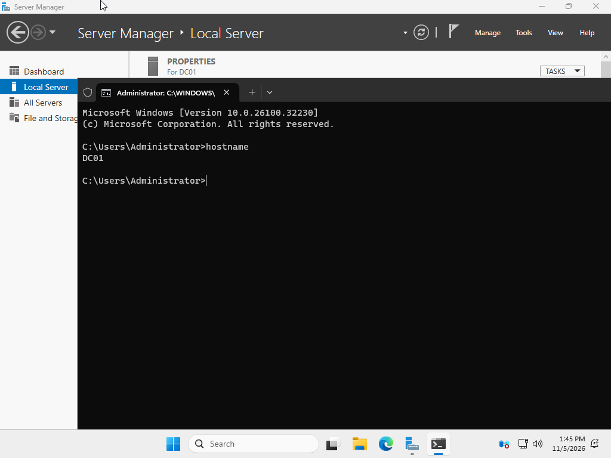

# Windows Server 2025 Installation and Initial Configuration

## Objective
Deploy and configure a Windows Server 2025 virtual machine as the foundation for an Active Directory home lab.

## Lab Environment
- Virtualization Platform: Oracle VirtualBox
- Operating System: Windows Server 2025 (Desktop Experience)
- Virtual Machine Name: DC01
- RAM: 4 GB
- Processors: 2
- Virtual Hard Disk: 100 GB
- Firmware: EFI

## Implementation

### 1. Virtual Machine Creation
- Created a new virtual machine in VirtualBox.
- Configured 4 GB of RAM, 2 virtual processors, and a 100 GB virtual hard disk.
- Enabled EFI firmware.

### 2. Windows Server Installation
- Downloaded the Windows Server 2025 evaluation ISO from Microsoft.
- Mounted the ISO to the virtual optical drive.
- Installed Windows Server 2025 with Desktop Experience.
- Created the local Administrator password.

### 3. Initial Server Configuration
- Opened Server Manager.
- Navigated to Local Server settings.
- Changed the Windows computer name to DC01.
- Left the server in the default WORKGROUP.
- Restarted to apply the changes.

## Verification
Opened Command Prompt and ran:

```cmd
hostname
```

Expected result:

```text
DC01
```

The following screenshot documents the hostname verification:



## Troubleshooting

### Issue: Virtual Machine Failed to Boot

**Symptom:** VirtualBox reported that the virtual machine failed to boot.

**Cause:** The virtual machine did not have bootable installation media attached.

**Resolution:**
1. Selected the downloaded Windows Server ISO.
2. Mounted the ISO to the virtual optical drive.
3. Restarted the VM and successfully launched the Windows Server installer.

**Outcome:** Windows Server installed successfully.

## Lessons Learned
- A virtual machine requires an operating system to function.
- ISO files can provide bootable operating system installation media.
- Virtual machine names and Windows computer names are configured separately.
- Consistent naming conventions help identify systems in an IT environment.
- The hostname command verifies a computer's assigned name.
