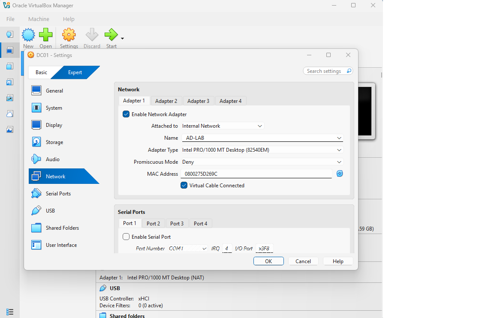
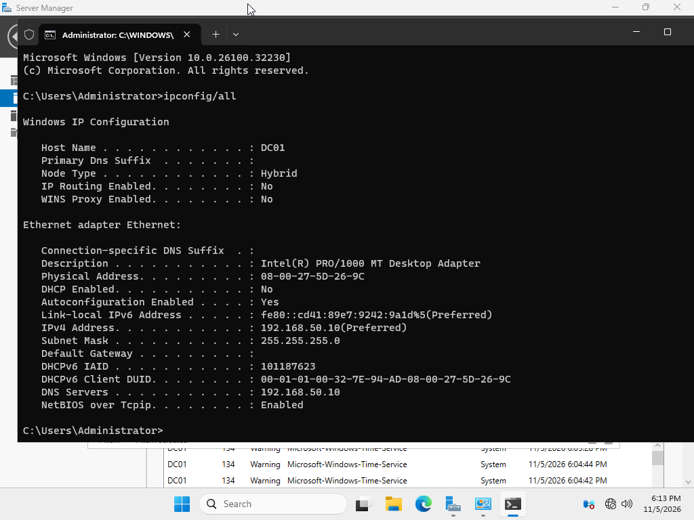

# Virtual Network and Static IP Configuration

## Objective
Configure an isolated virtual network and assign a static IP address to DC01 in preparation for deploying Active Directory Domain Services (AD DS).

## Lab Environment
- Virtualization: Oracle VirtualBox
- Operating System: Windows Server 2025
- Server Hostname: DC01
- Network Type: Internal Network
- Network Name: AD-LAB

## Network Configuration

| Setting | Value |
|---|---|
| Server | DC01 |
| IPv4 Address | 192.168.50.10 |
| Subnet Mask | 255.255.255.0 |
| Default Gateway | None |
| Preferred DNS | 192.168.50.10 |

## Implementation

### 1. Configure VirtualBox Networking
1. Powered off DC01.
2. Opened VirtualBox network settings.
3. Enabled Network Adapter 1.
4. Selected Internal Network.
5. Named the network AD-LAB.
6. Confirmed the virtual network cable was connected.

### Network Configuration Screenshot

### 2. Assign Static IP Address
1. Started DC01 and logged in.
2. Opened Server Manager.
3. Navigated to Local Server and opened Ethernet settings.
4. Opened IPv4 Properties.
5. Assigned the static IP address 192.168.50.10.
6. Configured the subnet mask and preferred DNS server.
7. Left the default gateway blank.

## Verification

Opened Command Prompt and executed:

`ipconfig /all`

Confirmed the following:
- IPv4 address: 192.168.50.10
- Subnet mask: 255.255.255.0
- DNS server: 192.168.50.10
- No default gateway configured

## Technical Explanation

### Why Use an Internal Network?
An Internal Network allows virtual machines connected to the same named network to communicate without direct access to the physical network or internet.

### Why Configure a Static IP?
Domain controllers provide critical network services. A consistent IP address allows domain clients to reliably locate the domain controller and its DNS service.

### Why Configure DNS to 192.168.50.10?
DC01 will host the DNS Server role when Active Directory is installed. The server is configured to use its own planned DNS service.

DNS functionality will be verified after the role is installed.

### Why Leave the Default Gateway Blank?
The internal network does not currently have a router providing access to other networks.

## Lessons Learned
- Differences between internal and external virtual networking.
- How to configure IPv4 settings manually.
- Why consistent IP addressing is important for domain controllers.
- How to inspect network configuration using ipconfig /all.

## Next Steps
- Install Active Directory Domain Services.
- Promote DC01 to a domain controller.
- Configure and verify Active Directory-integrated DNS.
- Create and connect a Windows 11 client workstation.
